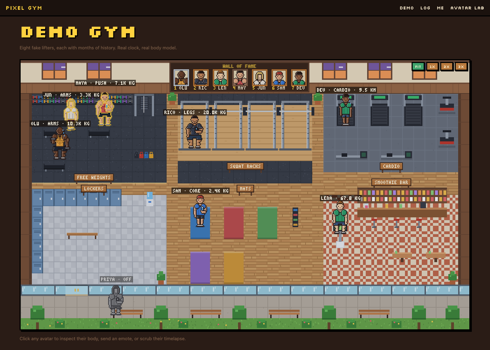

# Pixel Gym

You train in real life, and your pixel avatar trains too. Its body changes in ways you can see. Friends' avatars share the same gym floor.

**Live:** https://pixel-gym.vercel.app · demo floor with no login at [/demo](https://pixel-gym.vercel.app/demo)



It's a top-down pixel world (a 40×24 tile gym floor drawn with canvas 2D at 16px tiles, pixel-perfect up to 3×), split into real stations: free weights, four squat racks, a cardio strip, a mat zone, a smoothie bar with a scale, lockers, and a wall of fame. When you log a workout, your avatar walks (BFS pathfinding) to the matching station and starts lifting. If you haven't logged anything today, you sit greyed out on the bench outside.

## Pages

| Route | What |
| --- | --- |
| `/` | Landing page, live demo floor, create / join a floor |
| `/demo` | Seeded demo floor with 8 fake lifters (no login) |
| `/floor/[code]` | Your private floor. Polls every 30s. Click an avatar to inspect it or send an emote |
| `/log` | Quick log (exercise search, sets × reps × kg, cardio, bodyweight, rest day) plus Hevy / Strong CSV import |
| `/me` | Today's body, a 120-day heatmap, a timeline, a timelapse scrubber, and a share card |
| `/avatar-lab` | 6 sliders and a live 8× sprite, plus poses, effects and presets |

## Run it

```bash
npm install
npm run dev        # http://localhost:3000
npm test           # vitest: body model math + CSV parser
npm run build
```

Storage is one JSON document per floor. If `BLOB_READ_WRITE_TOKEN` is set, it goes to a private Vercel Blob store and writes use etag-based optimistic concurrency. Otherwise it goes to `.data/` on disk, so local dev needs no setup. There are no accounts: you pick a name and join a floor by its invite code, and an httpOnly cookie holds your member id plus a secret key.

## How the body model works

Six params, each from 0 to 10: **shoulders, arms, chest, back, legs, bodyfat**.

1. **Volume.** Every set is `sets × reps × load` (when kg is 0, load is a fraction of your bodyweight). A hardcoded map of 65 exercises (`src/lib/exercises.ts`) splits that volume across muscle groups. Bench, for example, is chest 1.0, shoulders 0.4, arms 0.4.
2. **Gain per training day** (`sessionGain`) = `GAIN × (1 − e^(−vol/V0)) × headroom(p) × junk`.
   - `1 − e^(−vol/V0)` gives diminishing returns within a session. Legs and back get a larger V0 because they move far more load.
   - `headroom(p) = ((10 − p)/10)^2.2`, so newbies grow fast and plateaus plateau.
   - `junk` scales gains down once trailing weekly volume passes 5 × V0.
3. **Bodyfat** goes down with cardio minutes and lifting days. It follows your bodyweight trend (an EMA of logged weights) and drifts slowly back toward average.
4. **Decay.** After 7 days with no log, every muscle param drops 0.1 per day.
5. **Pump.** On the day you train, worked muscles get a temporary boost that fades over about 4 hours, so a session shows up on the avatar right away. The permanent gain is smaller.
6. The whole history is replayed day by day (`simulate`), which gives the per-day snapshots behind the timelapse, the inspection card (day 1 / 30 days ago / today) and decay.

### Procedural sprite (`src/lib/sprite.ts`)

Each 32×48 avatar is built from separate layers: legs, shorts, shoes, torso, shirt, arms, folded forearms, delts, sleeves, head, hair and props. Each layer is sized from its own param by interpolating between **3 keyframes (small / mid / big)** of per-row widths. Layers get auto-outlined when stacked, so a big arm draws a line over the torso. There are no fixed sprite stages.

Secondary channels:

- **Shirt fit**: loose tee by default, a tight tee that shows the pecs and lats through the fabric once chest or shoulders pass 6, and a tank top once they pass 8.
- **Muscle detail**: pec lines, abs that show as bodyfat drops, lat shading, serratus, a delt separation line, bicep highlights and forearm veins, quad sweep and teardrop, calves.
- **Posture**: weak bodies slouch 1px, strong ones stand tall and bounce when they walk.
- **Skin saturation**: follows how many of the last 14 days you trained, so missed weeks look washed out.
- **Stance**: gets wider as legs grow, and big legs waddle on the walk cycle.
- **Effects**: sweat drops and damp shirt patches during a session, a gold outline glow for 15 minutes after a PR.

## Social

- A floor is a private group of up to 20 people, joined by a 6-character invite code.
- No chat, only emotes: fist bump, flex, clap. They show as pixel bubbles above the avatar.
- The wall of fame shows a weekly volume leaderboard for each floor as framed pixel portraits. Frame color follows your streak: wood, then bronze at 2+ days, silver at 5+, gold at 10+.
- A share card exports your avatar and stats as a PNG.

## Tests

`npm test` runs `src/lib/model.test.ts`. It covers the diminishing gains, the push-day zone and pump, the one-year plateau, decay timing, the bodyfat/cardio trend, PR detection, the CSV quoting and date formats, and imports of the Hevy fixture (`fixtures/hevy-sample.csv`) and a semicolon-delimited Strong fixture (`fixtures/strong-sample.csv`).

## Not in v1

- Apple Health XML import.
- Postgres. Neon provisioning through the Vercel Marketplace needs a human to accept the terms, so storage is Vercel Blob for now. Swapping in a database only touches `src/lib/server/store.ts`.
- Websockets. Polling every 30s is enough.
